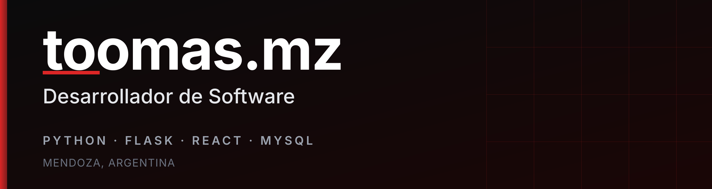

 

---

## Perfil

Desarrollador de software, con formación en Desarrollo de Software y experiencia en sistemas de gestión, bases de datos, interfaces web y APIs. Trabajo con metodologías ágiles y priorizo código mantenible, seguro y pensado para crecer.

Llevo adelante **Impulsar Studio**, mi emprendimiento, donde desarrollo sitios web, landing pages, catálogos digitales y sistemas a medida para negocios.

---

## Servicios

| Servicio | Descripción |
|---|---|
| Sitios web y landing pages | Presencia online rápida, clara y orientada a consultas |
| Catálogos y menús digitales | Productos y precios actualizados en tiempo real |
| Sistemas a medida | Gestión de clientes, turnos, stock o asistencias |
| Hosting y dominios | Publicación, dominio propio y mantenimiento |
| Mantenimiento de notebooks y PCs | Diagnóstico, reparación y puesta a punto |

---

## Tecnologías

| Área | Herramientas |
|---|---|
| Backend | Python, Flask |
| Frontend | React, TypeScript, JavaScript, Vite, HTML, CSS |
| Base de datos | MySQL, MySQL Workbench |
| Control de versiones | Git, GitHub |
| Deploy | Netlify, Hostinger |
| Gestión de proyectos | Jira |
| Inteligencia artificial | Claude, Claude Code |
| Sistema operativo | Windows |

---

## Proyectos

| Proyecto | Descripción | Tecnologías |
|---|---|---|
| [Impulsar Studio](https://github.com/Franv-Dev/ImpulsarStudio) | Desarrollo web para pequeños negocios | HTML, CSS, JavaScript |
| [Gestión de farmacia](https://github.com/Toomasmg/Gestion_farmacia_programacion) | Sistema de gestión para farmacia | Programación |
| [Gestor de seguros](https://github.com/Toomasmg/gestor-seguros) | Aplicación de gestión | Programación |
| [Guardian](https://github.com/Toomasmg/Guardian) | Sistema web de gestión de clientes y licencias | HTML |
| [Sloth](https://github.com/Toomasmg/sloth) | Herramienta para ejecutar varias sesiones de Claude Code en paralelo | TypeScript |
| [Vinificación API](https://github.com/Toomasmg/vinificacion_api) | API del proyecto de vinificación | Python |

**AsisTO** (proyecto académico en equipo): sistema de gestión de asistencias y seguimiento terapéutico para terapia ocupacional, con calendarios, objetivos medibles, evolución de pacientes y reportes.

---

## Estadísticas

---

## Contacto

Si tenés un negocio que necesita presencia online o una herramienta a medida, escribime y lo conversamos.

<!-- Completar con tu contacto profesional:
- LinkedIn: https://linkedin.com/in/TU-USUARIO
- Email: TU-EMAIL
-->
